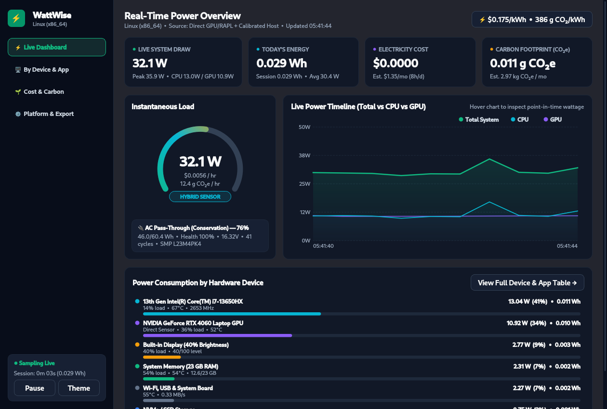
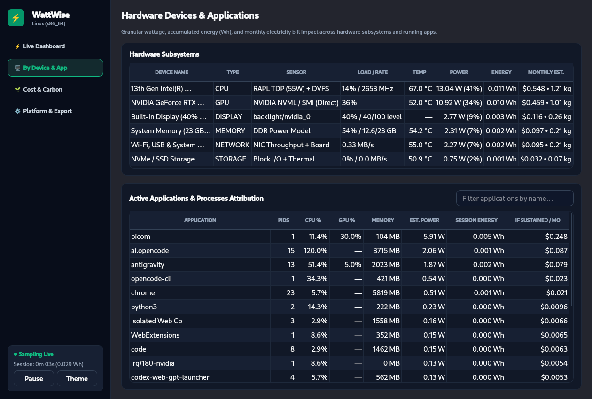
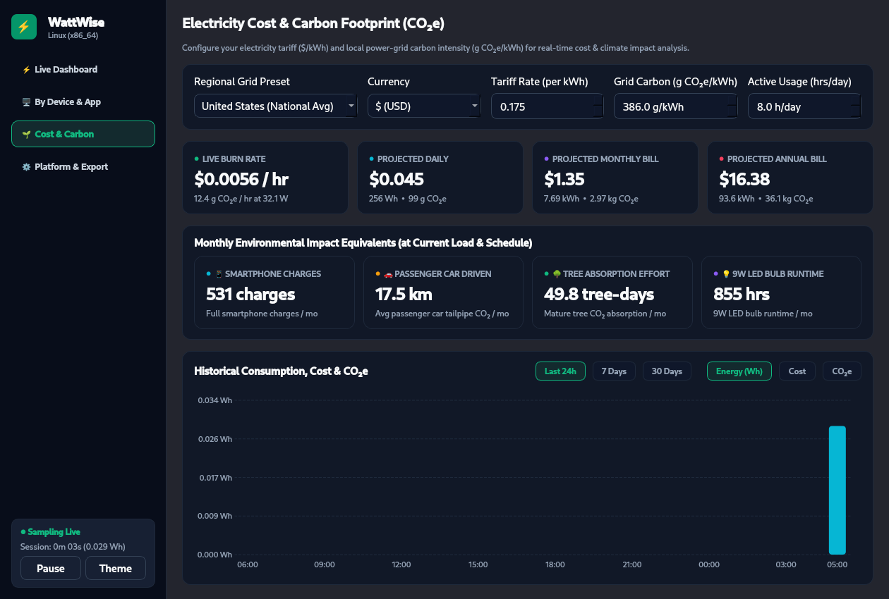

# ⚡ WattWise

[](https://github.com/aaka3h/wattwise/actions/workflows/ci.yml)
[](LICENSE)
[](pyproject.toml)
[-8B5CF6.svg)](#cross-platform-sensor-architecture)
[](CONTRIBUTING.md)

**WattWise** is a lightweight, open-source standalone native desktop application that tracks real-time hardware power consumption (`W` & `Wh`/`kWh`), per-device & per-application energy usage, **electricity cost (`$/kWh`)**, and **carbon footprint (`CO₂e`)** across **Linux**, **Windows**, **macOS Apple Silicon (M-Series)**, and **macOS Intel**.

---

## Preview

### Real-Time Power Overview


### Hardware Subsystems & Per-App Power Attribution


### Electricity Cost & Carbon Footprint (`CO₂e`)


---

## Highlights

- **Per-Device Hardware Telemetry**: Live wattage, load percentage, temperature, and cumulative session energy (`Wh`) across CPU Package/SoC, discrete & integrated GPUs, **Apple Neural Engine (ANE)**, display backlight, system memory (DRAM), NVMe/SSD storage, Wi-Fi/NIC & motherboard, and battery charge/discharge.
- **Per-Application Power Attribution**: Dynamically apportions active CPU time, GPU SM utilization (`nvidia-smi pmon`), memory footprint, and disk I/O throughput across running applications with instant search filtering.
- **Electricity Bill & Carbon (`CO₂e`) Calculator**:
  - **16 built-in regional presets** (US Avg, California, EU Avg, UK, Germany, France, Nordic Hydro, India, Singapore, Malaysia, China, Japan, Australia, Canada, Global Avg, and Custom) with **9 currencies** (`$`, `€`, `£`, `₹`, `S$`, `RM`, `¥`, `A$`, `C$`).
  - Live hourly burn rate, daily/monthly/annual cost & carbon projections, plus intuitive environmental equivalents (smartphone charges, passenger car `km`, tree-days, and 9W LED bulb runtime).
- **Local SQLite History & One-Click Export**: Logs power telemetry locally with interactive **Last 24h**, **7 Days**, and **30 Days** bar charts, plus **CSV** and **JSON** export.
- **Fast Native Qt6 Desktop UI**: Custom anti-aliased `QPainter` gauges & multi-series hover charts, **Obsidian Dark** & **Daylight Frost** themes, non-blocking background telemetry thread, and optional System Tray mode.

---

## Installation & Quick Start

Requires **Python 3.10+**.

### 1. Clone & Install

**Linux / macOS (Apple Silicon & Intel):**
```bash
git clone https://github.com/aaka3h/wattwise.git
cd wattwise
python3 -m venv .venv
source .venv/bin/activate
pip install -e .

# Launch the native desktop GUI
wattwise
```

**Windows (PowerShell):**
```powershell
git clone https://github.com/aaka3h/wattwise.git
cd wattwise
python -m venv .venv
.\.venv\Scripts\Activate.ps1
pip install -e .

# Launch the native desktop GUI
wattwise
```

### 2. Terminal CLI & JSON Modes

```bash
# Print a formatted hardware & application power report in the terminal
wattwise --cli

# Emit structured JSON snapshot + cost & CO2e projections
wattwise --json
```

---

## Packaging Standalone Native Desktop Bundles

Build a self-contained native desktop app (`.exe` on Windows, `.app` bundle on macOS Apple Silicon & Intel, or single-file binary on Linux):

```bash
pip install -e ".[dev]"
python scripts/build_desktop.py
```

Artifacts are generated in `dist/`:
- **Windows**: `dist/WattWise.exe` (windowed executable with zero console flashes)
- **macOS (Apple Silicon `arm64` & Intel `x86_64`)**: `dist/WattWise.app`
- **Linux**: `dist/WattWise` (plus optional desktop menu launcher via `./scripts/install_linux_desktop.sh`)

Automated multi-OS release builds and CI tests are configured in [`.github/workflows/build-desktop.yml`](.github/workflows/build-desktop.yml) and [`.github/workflows/ci.yml`](.github/workflows/ci.yml).

---

## Cross-Platform Sensor Architecture

| Platform | Total System & Battery | CPU / SoC | GPU / Accelerators | Display & Peripherals |
| :--- | :--- | :--- | :--- | :--- |
| **Linux** (`x86_64`, `ARM64`, Asahi) | `/sys/class/power_supply/*` (`BAT*`, `ACAD`, USB-C PD) + Intel `psys` | Intel/AMD RAPL (`powercap`), `zenpower`/`amd_energy` `hwmon`, or RAPL TDP + DVFS model | NVIDIA `nvidia-smi` + `pmon`, DRM `amdgpu` / `i915` `hwmon` | `/sys/class/backlight/*`, block/NIC throughput, `nvme`/`spd5118` thermals |
| **Windows 10/11** (`x64` & `ARM64`) | Win32 `GetSystemPowerStatus`, WMI `BatteryStatus` (`DischargeRate`/`ChargeRate`), Windows EMI `PowerMeter` | LibreHardwareMonitor WMI (if running) or calibrated TDP + DVFS frequency model | NVIDIA `nvidia-smi` + `pmon`, LibreHardwareMonitor WMI, iGPU model | `WmiMonitorBrightness` + Disk/NIC I/O deltas |
| **macOS Apple Silicon** (`M1`–`M4+` `arm64`) | Unprivileged IOKit `AppleSmartBattery` `TelemetryData` (`SystemLoad` / `SystemPowerIn` on AC & battery) | P-core / E-core Apple Silicon profile, auto-upgrading to `powermetrics` when privileged | Integrated Apple GPU + **Apple Neural Engine (ANE)** | Retina display + Unified Memory + Apple NVMe I/O |
| **macOS Intel** (`x86_64`) | Unprivileged IOKit `AppleSmartBattery` (`InstantAmperage * Voltage` & `TelemetryData`) | Intel Mac TDP + utilization model or `powermetrics` package watts | macOS GPU telemetry / estimate | Retina / external display + DDR + Disk/NIC I/O |

> **Linux Tip (Direct Unprivileged CPU RAPL Counters):** On Linux kernels where `/sys/class/powercap/intel-rapl*/energy_uj` is `0400` (`root`), WattWise automatically reads your CPU's hardware TDP constraint + live DVFS scaling, and seamlessly switches to direct hardware RAPL counters if read access is enabled:
> ```bash
> sudo chmod o+r /sys/class/powercap/intel-rapl*/energy_uj
> ```

---

## Contributing — Everyone Is Welcome! 🤝

Contributions of all kinds are warmly welcomed — whether adding your country's electricity tariff & grid carbon factor, testing sensors on your laptop/desktop, improving UI charts, or fixing bugs!

- Read the step-by-step **[Contribution Guide (`CONTRIBUTING.md`)](CONTRIBUTING.md)** to set up your dev environment in under 2 minutes.
- Run the automated test suite anytime with:
  ```bash
  pytest -v
  ```
- Please review our **[Code of Conduct (`CODE_OF_CONDUCT.md`)](CODE_OF_CONDUCT.md)**.

---

## License

Released under the **[MIT License](LICENSE)** — free for personal, academic, and commercial use.
